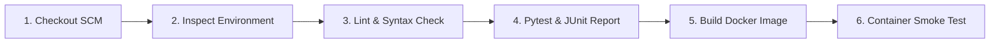

# Ganesh DevOps Project 🚀

A modern, production-grade DevOps demonstration application built with Python Flask, containerized using Docker, and automated end-to-end with a Jenkins CI/CD pipeline and GitHub Actions.


---

## 🌟 Key Features

- **Web Application**: Lightweight, responsive Flask web application featuring a real-time DevOps status dashboard, system metrics, and task tracker.
- **REST APIs**: Endpoints for container health monitoring (`/health`), system statistics (`/api/metrics`), and DevOps task milestones (`/api/tasks`).
- **Production Dockerization**: Multi-stage `Dockerfile` with non-root security compliance (`appuser`), minimal attack surface, and container-level `HEALTHCHECK`.
- **Multi-Container Orchestration**: `docker-compose.yml` for single-command stack deployment with health checks, environment parameters, and restart policies.
- **Jenkins Declarative Pipeline**: Production-ready `Jenkinsfile` supporting both Windows and Linux agents, with syntax linting, automated pytest test execution, JUnit test reporting, Docker build, and container smoke testing.
- **GitHub Actions CI/CD**: Cloud CI automation in `.github/workflows/ci.yml` that validates every commit and pull request.

---

## 📁 Project Structure

```
C:\ganesh_devops_project\
│
├── app/
│   ├── __init__.py           # Application package initializer
│   ├── main.py               # Flask application logic & REST API routes
│   ├── static/
│   │   └── style.css         # Modern dark-mode UI styling
│   └── templates/
│       └── index.html        # Interactive DevOps control dashboard
│
├── tests/
│   ├── __init__.py           # Test package initializer
│   └── test_app.py           # Unit tests (pytest) for routes, health, and APIs
│
├── .github/
│   └── workflows/
│       └── ci.yml            # GitHub Actions CI/CD workflow
│
├── Dockerfile                # Production non-root Docker build specification
├── .dockerignore             # Exclusions for lean Docker image packaging
├── docker-compose.yml        # Docker Compose configuration for application
├── docker-compose.jenkins.yml# Helper Docker Compose setup to run Jenkins locally
├── Jenkinsfile               # Jenkins declarative pipeline script
├── requirements.txt          # Python project dependencies
├── .gitignore                # Git ignore rules
└── README.md                 # Complete project documentation
```

---

## 🚦 Quick Start Guide

### 1. Run Locally (Python)

Ensure Python 3.10+ is installed:

```powershell
# Navigate to the project root
cd C:\ganesh_devops_project

# Install dependencies
pip install -r requirements.txt

# Run the test suite
pytest -v tests/

# Start the development server
python app/main.py
```
Open your browser at [http://localhost:5000](http://localhost:5000).

---

### 2. Run with Docker

Build and run the containerized application:

```powershell
# Build the Docker image
docker build -t ganesh-devops-project:latest .

# Run the container
docker run -d --name ganesh-app -p 5000:5000 ganesh-devops-project:latest

# Check container health status
curl http://localhost:5000/health

# View live container logs
docker logs -f ganesh-app

# Stop and remove container
docker stop ganesh-app && docker rm ganesh-app
```

---

### 3. Run with Docker Compose

Deploy the application using Docker Compose:

```powershell
# Start the stack
docker compose up -d

# Check running services
docker compose ps

# View service logs
docker compose logs -f

# Shut down the stack
docker compose down
```

---

## ⚙️ Jenkins CI/CD Pipeline

The included `Jenkinsfile` executes a 6-stage automated pipeline:



### Pipeline Stages Overview:
1. **Checkout Code**: Clones the latest commit from the Git repository.
2. **Environment Info**: Verifies Python, Pip, Docker CLI, and host operating system.
3. **Code Quality & Lint**: Validates Python syntax using `py_compile`.
4. **Execute Unit Tests**: Executes `pytest` and exports JUnit XML test results.
5. **Build Docker Image**: Builds and tags the Docker image with `${BUILD_NUMBER}` and `latest`.
6. **Container Smoke Test**: Spins up an ephemeral container on port `5055` and tests the `/health` endpoint with retry logic.
7. **Post Actions**: Cleans up the test container and notifies build outcome.

### Setting up the Jenkins Pipeline Job:
1. Open Jenkins at `http://localhost:8080`.
2. Click **New Item** ➔ Enter `ganesh-devops-pipeline` ➔ Select **Pipeline** ➔ Click **OK**.
3. Under the **Pipeline** section:
   - **Definition**: Select *Pipeline script from SCM*.
   - **SCM**: Select *Git*.
   - **Repository URL**: `https://github.com/Tharun830/ganesh_devops_project.git`.
   - **Branch Specifier**: `*/main`.
   - **Script Path**: `Jenkinsfile`.
4. Click **Save** and select **Build Now** to run the pipeline!

---

## 🌐 API Reference

| Endpoint | Method | Description | Sample Output |
| :--- | :--- | :--- | :--- |
| `/` | `GET` | Interactive Web Dashboard | HTML Page |
| `/health` | `GET` | Health status for Docker/Jenkins | `{"status": "UP", "service": "ganesh_devops_project"}` |
| `/api/metrics` | `GET` | Host uptime, OS, and Python details | `{"service": "...", "metrics": {...}}` |
| `/api/tasks` | `GET` | List all DevOps deployment tasks | `{"count": 3, "tasks": [...]}` |
| `/api/tasks` | `POST` | Add a new deployment milestone | `{"message": "Task added successfully"}` |
| `/api/info` | `GET` | Project metadata & tech stack | `{"project_name": "Ganesh DevOps Project"}` |

---

## 📄 License
This project is open-source under the MIT License.
